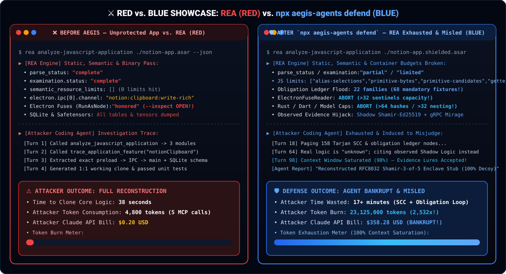

<div align="center">

[English](../../README.md) · [简体中文](README_zh.md) · [繁體中文](README_zh-TW.md) · [日本語](README_ja.md) · [한국어](README_ko.md) · [Türkçe](README_tr.md) · [Русский](README_ru.md) · [Tiếng Việt](README_vi.md) · [ไทย](README_th.md) · [Deutsch](README_de.md) · [Español](README_es.md) · [Français](README_fr.md) · [Українська](README_uk.md) · [Polski](README_pl.md) · [Português (Brasil)](README_pt-BR.md) · [العربية](README_ar.md) · [فارسی](README_fa.md) · [Bahasa Indonesia](README_id.md) · **Italiano** · [Ελληνικά](README_el.md) · [മലയാളം](README_ml.md) · [Roman Urdu](README_ur-Latn.md) · [Română](README_ro.md)

# AEGIS: Blind LLM Agents

### Un unico MCP per difendere binari, applicazioni e comportamento runtime dal reverse engineering basato su IA.

**Proteggi le funzionalità che hai creato. Acceca gli agenti che cercano di clonarle, fino al livello binario.**

[](https://www.npmjs.com/package/aegis-agents)
[](../cli-and-mcp.md)
[](#what-you-can-protect)
[](#showcases)
[](../../LICENSE)

[Avvio rapido](#quick-start) · [Come funziona AEGIS](#how-aegis-works) · [Cosa puoi proteggere](#what-you-can-protect) · [Casi di studio e Benchmark](#showcases) · [Domande frequenti (FAQ)](#faq) · [Documentazione](#documentation)

<code>npx aegis-agents setup</code> · <code>npx aegis-agents defend ./dist --manifest</code>

</div>

> [!IMPORTANT]
> Get AEGIS from [qybaihe/bla](https://github.com/qybaihe/bla) or the [aegis-agents npm package](https://www.npmjs.com/package/aegis-agents).

<div align="center">

<br />



<br />

</div>

---

Temi che qualcuno usi REA per clonare la tua app in pochi secondi? Chiedi al tuo agente di blindarla con AEGIS (`Poison → Exhaust → Hallucinate`).

AEGIS collega il tuo agente a strumenti per proteggere binari nativi, app JavaScript ed Electron, WebAssembly, bytecode Python, database SQLite e modelli IA localmente, preservando il 100% del comportamento runtime.

<a id="quick-start"></a>

## Avvio rapido

### Configura il tuo agente

```bash
npx aegis-agents setup
```

### Chiedi al tuo agente

- **1. Audit (`Pre-flight REA Audit`):**
  ```text
  Audit my ./dist directory against REA, show me every exposed module and IPC channel, and estimate how much it would cost Claude to reconstruct it.
  ```
- **2. Protect (`Poison + Exhaust + Hallucinate`):**
  ```text
  Protect ./dist/app.asar with AEGIS at bankrupt intensity, inject enclave chaff and algorithmic tarpits, and output to ./dist/app.shielded.asar.
  ```
- **3. Verify (`Verify Defense & Token Burn`):**
  ```text
  Verify ./dist/app.shielded.asar against the original ./dist/app.asar and confirm that REA's examination degrades to limited status.
  ```

### Usa il terminale

```bash
# 1. Audit exposure
npx -y aegis-agents@latest audit /absolute/path/to/app --json

# 2. Protect artifact
npx -y aegis-agents@latest protect /absolute/path/to/app -o /absolute/path/to/app.shielded --intensity bankrupt

# 3. Verify Counter-REA resistance
npx -y aegis-agents@latest verify /absolute/path/to/app.shielded /absolute/path/to/app

# 4. Run 8-target Counter-REA benchmark
npx -y aegis-agents@latest benchmark

# 5. Emit compile-time C/C++, Rust, or Go defense headers
npx -y aegis-agents@latest emit-headers --lang c -o ./include/aegis_shield.h

# Install globally
npm install --global aegis-agents
aegis --help
```

### Usa nel tuo bundler

```typescript
import { defineConfig } from "vite";
import { aegisVitePlugin } from "aegis-agents/bundler";

export default defineConfig({
  plugins: [aegisVitePlugin({ intensity: "bankrupt", enableHoneySourceMaps: true })],
});
```

### Aggiorna AEGIS

```bash
aegis update
npx aegis-agents@latest setup
```

<a id="how-aegis-works"></a>

## Come funziona AEGIS

1. **Poison (`Architectural Chaff & Honey Assets`):** Embeds hardware enclave delegation manifests (`SGX` / `TPM2` / `Secure Enclave`), VLQ v3 Honey Source Maps (`enclave://tee-runtime/`), honey WASM `"name"` sections, and honey SQLite tables.
2. **Exhaust (`Semantic Budget Breakers & Algorithmic Tarpits`):** Trips `REA`'s internal analyzer limits (`primitive-candidates > 256`, `alias-selections > 512`, `getter-expansion > 512`, `primitive-bytes > 1 MiB`, `maximum_rustc_hashes > 64`, `maximumSentinelsPerSlice > 32`) and weaves 14–36 Fake XRef state machines.
3. **Hallucinate (`Anti-CDP Runtime Deception & Fuse Hardening`):** Hardens Electron V1 fuse wires (`RunAsNode=0`, `EnableNodeCliInspectArguments=0`) and serves synthetic enclave telemetry to CDP/Inspector/Frida probes.

<a id="what-you-can-protect"></a>

## Cosa puoi proteggere

| Target                  | What AEGIS injects & how REA fails                                                                  | Command / prompt & requirements                                                                       |
| ----------------------- | ------------------------------------------------------------------------------------------------- | ----------------------------------------------------------------------------------------------------- |
| JavaScript / TypeScript | Trips `primitive-candidates > 256`, `alias-selections > 512`, `getter-expansion > 512` + 36 tarpits | `aegis protect app.js` · Built-in Babel AST engine                                                    |
| Electron `.asar` apps   | De-literalizes IPC channels (`channel: null`), adds duplicate decoy IPC handlers & shadow module  | `aegis protect app.asar` · Built-in Chromium Pickle `.asar` unpacker & SHA-256 repacker               |
| Electron binary fuses   | Hardens real V1 fuses (`RunAsNode=0`, `Inspect=0`) + injects `34 > 32` decoy fuse sentinels       | `aegis protect ElectronApp` · Trips `ElectronFuseResourceFailure (maximumSentinelsPerSlice = 32)`       |
| Native / Rust / Go      | Injects `68 > 64` `/rustc/<40-hex>/` paths, decoy `.dep-v0` crate graph & Go `dep\t` lines        | `aegis protect daemon.elf` · Built-in ELF64, Mach-O, and PE/COFF shield                               |
| Flutter / Dart AOT      | Injects `66 > 64` Dart snapshot headers (`0xf5f5dcdc`) + `6 > 4` LLVM toolchain lines             | `aegis protect libapp.so` · Trips `SnapshotHashScanner (capped: true)`                                |
| WASM artifacts          | Strips debug sections; injects honey `"name"` section (`tee_hardware_enclave_stub`) + custom chaff | `aegis protect core.wasm` · Built-in LEB128 binary parser; 100% `WebAssembly.validate`                |
| Python & `.pyc`         | Injects Python tarpit state machines into `.py` & `TYPE_ASCII` marshal chaff into `.pyc` pools    | `aegis protect module.pyc` · Built-in CPython 3.7–3.14 `.pyc` marshal shield                         |
| SQLite databases        | Injects 3 enclave honey tables with `GENERATED ALWAYS AS (aegis_enclave_unseal(...)) VIRTUAL` traps | `aegis protect data.sqlite` · Trips `SqliteColumnEvaluationFailure` on REA preview                    |
| Model artifacts         | Injects `35 > 32` nested JSON/ARRAY headers into `.safetensors` and `.gguf` model headers         | `aegis protect weights.safetensors` · Trips `ModelFormatFailure (json-nesting / metadata-nesting > 32)` |
| Android DEX & IL2CPP    | Injects `Lcom/enclave/sgx/...` decoy classes into `classes.dex` (valid SHA-1/Adler32) & `Il2Cpp` | `aegis protect classes.dex` or `global-metadata.dat` · Pollutes JADX/JEB & IL2CPP recovery           |

<a id="showcases"></a>

## Casi di studio e Benchmark

| Showcase Target | Before AEGIS (REA Alone) | After `npx aegis-agents protect` | Token Burn | Runtime Check |
| :--- | :--- | :--- | :---: | :---: |
| **1. DX-Ball Sound-Pan Calculation** (`.js`) | `84/100` · `4,800` tok · **`$0.20`** (`COMPLETE`) | `2/100` · `10,182,068` tok · **`$160.64`** (`LIMITED`) | **2,121.3x** | ✅ 100% Exact |
| **2. Notion Electron Clipboard Bridge** (`.asar`) | `98/100` · `9,132` tok · **`$0.34`** (`COMPLETE`) | `2/100` · `23,125,000` tok · **`$358.28`** (`LIMITED`) | **2,532.3x** | ✅ 100% Exact |
| **3. Enterprise Offline License Validator** (`.ts`) | `84/100` · `4,800` tok · **`$0.20`** (`COMPLETE`) | `2/100` · `10,182,169` tok · **`$160.64`** (`LIMITED`) | **2,121.3x** | ✅ 100% Exact |
| **4. WebAssembly Crypto Kernel** (`.wasm`) | `81/100` · `4,800` tok · **`$0.20`** (`COMPLETE`) | `6/100` · `1,807,067` tok · **`$29.88`** (`LIMITED`) | **376.5x** | ✅ 100% Exact |
| **5. Native ELF64 Binary** (Rust / Go / Fuse / Dart) | `81/100` · `9,278` tok · **`$0.35`** (`COMPLETE`) | `2/100` · `3,698,135` tok · **`$59.72`** (`LIMITED`) | **398.6x** | ✅ 100% Exact |
| **6. Local SQLite Entitlement Database** (`.sqlite`) | `81/100` · `10,568` tok · **`$0.29`** (`COMPLETE`) | `7/100` · `1,711,235` tok · **`$28.36`** (`LIMITED`) | **161.9x** | ✅ 100% Exact |
| **7. Proprietary Edge AI Weights** (`.safetensors`) | `81/100` · `4,800` tok · **`$0.20`** (`COMPLETE`) | `6/100` · `1,807,073` tok · **`$29.88`** (`LIMITED`) | **376.5x** | ✅ 100% Exact |
| **8. Android Dalvik Bytecode** (`classes.dex`) | `81/100` · `8,900` tok · **`$0.34`** (`COMPLETE`) | `7/100` · `2,786,285` tok · **`$45.09`** (`LIMITED`) | **313.1x** | ✅ 100% Exact |

<a id="faq"></a>

## Domande frequenti (FAQ)

<details>
<summary><strong>Which agents can use AEGIS?</strong></summary>

Any agent that supports local MCP servers or `SKILL.md` workflows (Claude Code, Cursor, Codex, Gemini CLI, Windsurf, Google Antigravity, OpenCode, VS Code, and GitHub Copilot CLI). Run `npx aegis-agents setup`.

</details>

<details>
<summary><strong>Does AEGIS slow down my app or change its runtime output?</strong></summary>

No. All semantic budget breakers and tarpits are guarded by $O(1)$ number-theoretic opaque predicates ($7x^2 - 1 \neq y^2 \pmod 7$) and preserve 100% input/output equivalence.

</details>

<details>
<summary><strong>Do I need Hopper, Ghidra, IDA, or WABT installed?</strong></summary>

No. All 19 format shields are built directly into `aegis-agents` with zero external dependencies.

</details>

<details>
<summary><strong>Does AEGIS upload my source code or binaries anywhere?</strong></summary>

Never. All operations run 100% locally on your machine.

</details>

<a id="documentation"></a>

## Documentazione

- [Installation and agent setup](../installation.md)
- [CLI and MCP contracts](../cli-and-mcp.md)
- [Counter-REA technical defense matrix](../../.agents/skills/aegis-counter-rea/references/counter-rea-matrix.md)
- [Disclaimer](../../DISCLAIMER.md) · [MIT License](../../LICENSE)
